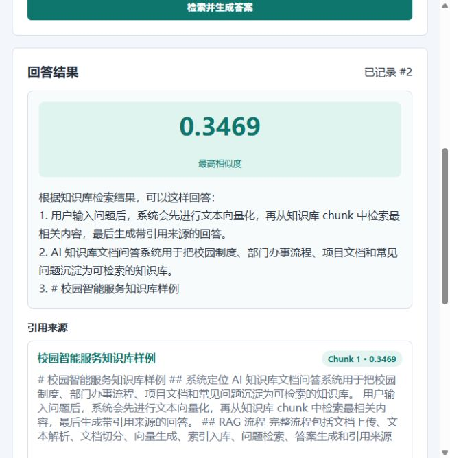
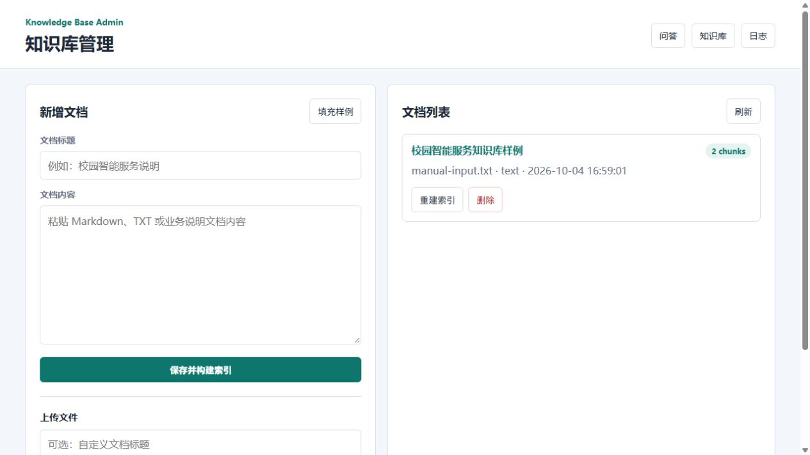
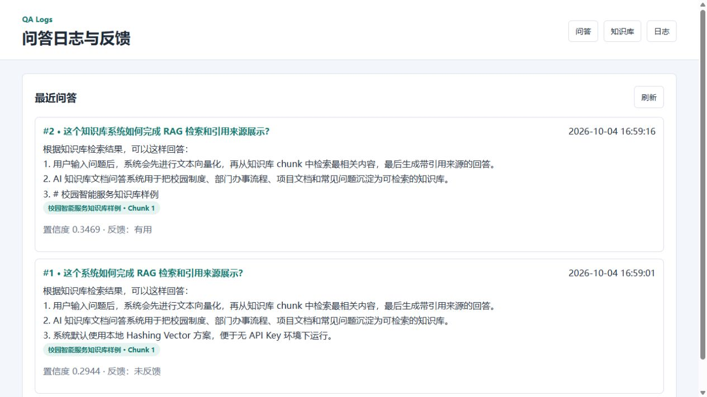

# AI 知识库文档问答系统

一个面向企业内部知识库和校园办事文档的 RAG 问答系统。系统支持上传文档、自动切分 chunk、构建本地向量索引、根据问题检索相关内容、生成带引用来源的回答，并记录问答日志和用户反馈。

项目默认使用本地 Hashing Vector 检索，便于无 API Key 环境下直接运行；后续可平滑升级为 OpenAI Embedding、sentence-transformers、FAISS 或 Chroma。

## 页面预览

### RAG 问答与引用来源



### 知识库后台管理



### 问答日志与反馈闭环



## 功能特性

- 支持 TXT、Markdown、CSV、JSON、PDF 文档上传
- 支持手动新增知识库文本
- 自动进行文本清洗、切分 chunk、向量化和索引构建
- 根据用户问题进行向量检索
- 生成带引用来源的回答
- 后台管理知识库文档
- 支持删除文档、重建索引
- SQLite 保存文档、chunk、问答日志和反馈记录
- 用户可标记回答“有用 / 无用”，形成数据反馈闭环
- 提供 FastAPI 接口和可视化页面

## 技术栈

- 后端：Python、FastAPI、Pydantic
- 数据库：SQLite
- 文档解析：TXT / Markdown / CSV / JSON / PDF(pypdf)
- 检索：文本切分、Hashing Vector、余弦相似度
- 前端：HTML、CSS、JavaScript

## 项目亮点

- 覆盖 RAG 应用的完整链路：文档解析、chunk 切分、向量化、检索、答案生成、引用来源
- 不依赖外部大模型 API，适合本地演示和面试展示
- 有后台管理、日志记录和反馈闭环，更像可维护系统而不是简单 Demo
- 预留向量数据库升级方向，可扩展到 FAISS、Chroma 或企业知识库场景

## 快速开始

```bash
pip install -r requirements.txt
uvicorn app.main:app --reload --port 8030
```

访问：

- 问答页面：http://127.0.0.1:8030/
- 知识库管理：http://127.0.0.1:8030/admin
- 问答日志：http://127.0.0.1:8030/logs
- API 文档：http://127.0.0.1:8030/docs

## 使用流程

1. 打开知识库管理页面
2. 粘贴文本或上传文档
3. 系统自动切分文本并构建索引
4. 在问答页面输入问题
5. 查看答案、置信度和引用来源
6. 对回答进行有用 / 无用反馈
7. 在日志页面查看问答历史和反馈结果

## API 示例

### 新增文本知识

```http
POST /api/documents/text
Content-Type: application/json

{
  "title": "校园服务说明",
  "content": "系统支持文档上传、文本切分、向量检索、引用来源展示和用户反馈。"
}
```

### 提问

```http
POST /api/ask
Content-Type: application/json

{
  "question": "系统如何完成 RAG 检索？",
  "top_k": 5
}
```

### 反馈

```http
POST /api/logs/{log_id}/feedback
Content-Type: application/json

{
  "feedback": "useful"
}
```

## 项目结构

```text
doc-rag-qa-system/
├── app/
│   ├── main.py        # FastAPI 入口
│   ├── database.py    # SQLite 数据访问
│   └── rag.py         # 文档切分、向量化、检索和答案生成
├── static/
│   ├── index.html     # 问答页面
│   ├── admin.html     # 知识库管理页面
│   ├── logs.html      # 问答日志页面
│   └── *.js / *.css
├── samples/
│   └── campus_service_guide.md
├── data/
├── docs/images/
├── requirements.txt
└── README.md
```

## 后续可扩展

- 接入 OpenAI Embedding 或 sentence-transformers
- 使用 FAISS / Chroma 存储向量索引
- 接入 LLM 生成更自然的回答
- 增加用户权限、知识库空间、多文件批量导入
- 支持 DOCX、网页 URL、飞书/Notion/企业微信文档接入
